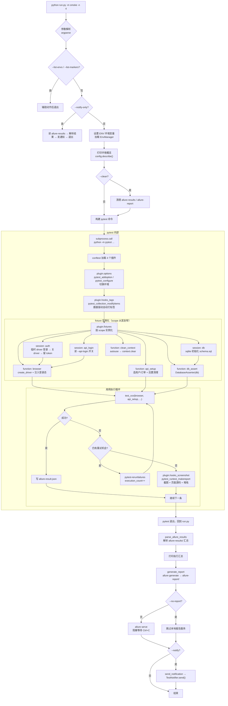
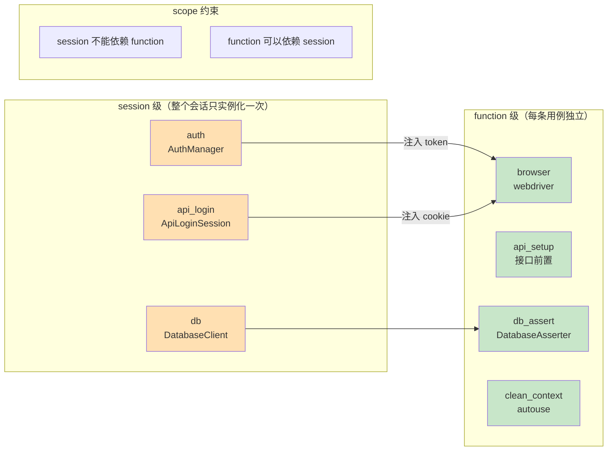
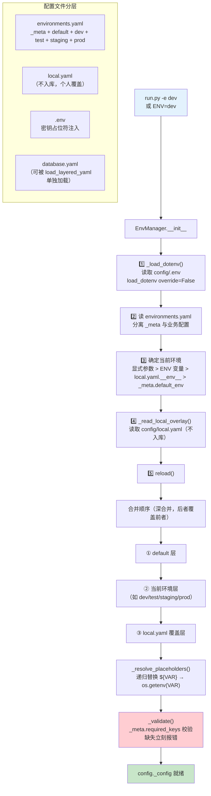
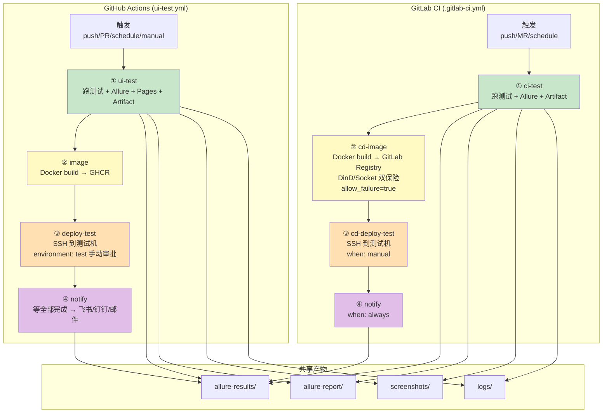
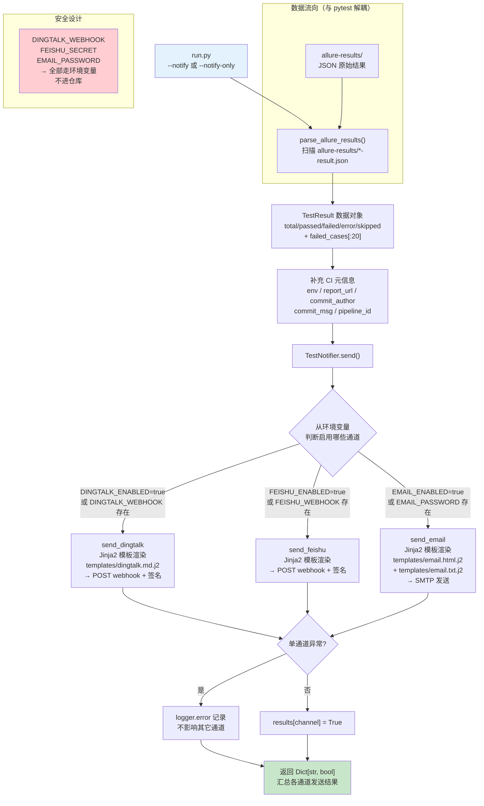
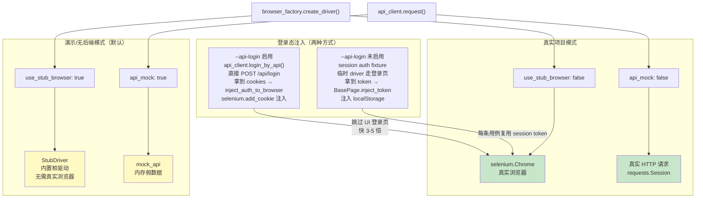

# UI 自动化框架 — 系统链路全景图

> 项目根目录所有文件的链路梳理，共 8 张 Mermaid 逻辑图。
> Lark 文档原生支持 Mermaid 代码块渲染，复制粘贴即可。

---

## 目录

- [一、项目整体架构](#一项目整体架构)
- [二、测试执行主链路](#二测试执行主链路)
- [三、pytest fixture 依赖拓扑](#三pytest-fixture-依赖拓扑)
- [四、多环境配置加载链路](#四多环境配置加载链路)
- [五、CI/CD 流水线对比](#五cicd-流水线对比)
- [六、通知系统链路](#六通知系统链路)
- [七、浏览器与接口双轨设计](#七浏览器与接口双轨设计)
- [八、目录结构速查](#八目录结构速查)

---

## 一、项目整体架构

```mermaid
graph TD
    subgraph "外部入口"
        CLI["run.py<br/>统一执行入口"]
        GH["GitHub Actions<br/>ui-test.yml"]
        GL["GitLab CI<br/>.gitlab-ci.yml"]
        DK["Docker / docker-compose"]
    end

    subgraph "pytest 运行时"
        direction LR
        CONF["conftest.py<br/>插件装配"]
        PLUG_OPTS["plugin/options<br/>命令行参数"]
        PLUG_FIX["plugin/fixtures<br/>全部 fixture"]
        PLUG_TAG["plugin/hooks_tags<br/>自动打标签"]
        PLUG_SS["plugin/hooks_screenshot<br/>失败截图"]
    end

    subgraph "core 核心模块 common/"
        ENV["env_manager<br/>多环境配置"]
        LOG["logger<br/>日志双通道"]
        CTX["global_context<br/>全局上下文"]
        BF["browser_factory<br/>浏览器工厂"]
        AM["auth_manager<br/>登录态管理"]
        API["api_client<br/>接口客户端"]
        DB["db/db_client<br/>数据库连接"]
        DA["db/assertion<br/>数据库断言"]
        SS["screenshot<br/>失败截图"]
        NR["notifier<br/>通知门面"]
        STUB["stub_driver<br/>桩驱动"]
        MOCK["mock_api<br/>内存桩"]
    end

    subgraph "页面对象 pages/"
        BP["base_page<br/>基类"]
        LP["login_page"]
        OP["order_page"]
    end

    subgraph "测试用例 testcases/"
        TC1["test_login"]
        TC2["test_order"]
        TC3["test_api_setup_demo"]
        TC4["test_db_assert_demo"]
        TC5["test_retry_demo"]
    end

    subgraph "配置层 config/"
        EY["environments.yaml"]
        LY["local.yaml<br/>（不入库）"]
        DY["database.yaml"]
        DV[".env<br/>密钥注入"]
    end

    subgraph "通知通道"
        ND["channels/dingtalk"]
        NF["channels/feishu"]
        NE["channels/email"]
        TP["templates/*.j2"]
    end

    subgraph "产物"
        AR["allure-results/"]
        AP["allure-report/"]
        LG["logs/"]
        SC["screenshots/"]
        JX["report.xml"]
    end

    CLI --> CONF
    GH --> CLI
    GL --> CLI
    DK --> CLI

    CONF --> PLUG_OPTS
    CONF --> PLUG_FIX
    CONF --> PLUG_TAG
    CONF --> PLUG_SS

    PLUG_OPTS --> ENV
    PLUG_FIX --> BF
    PLUG_FIX --> AM
    PLUG_FIX --> API
    PLUG_FIX --> DB
    PLUG_FIX --> BP
    PLUG_SS --> SS

    ENV --> EY
    ENV --> LY
    ENV --> DV
    ENV --> LOG
    ENV --> API
    ENV --> BF

    BF --> STUB
    BF --> |use_stub_browser=false| SEL["selenium.Chrome"]

    API --> |api_mock=true| MOCK
    API --> CTX

    AM --> CTX
    LOG --> CTX

    BP --> LP
    BP --> OP
    BP --> ENV

    TC1 --> LP
    TC2 --> OP
    TC3 --> API
    TC4 --> DA
    TC5 --> PLUG_SS

    TC1 & TC2 & TC3 & TC4 & TC5 --> AR
    AR --> AP
    AR --> JX
    PLUG_SS --> SC
    LOG --> LG

    CLI --> NR
    NR --> ND
    NR --> NF
    NR --> NE
    ND & NF & NE --> TP
    NR --> AR
```

**核心洞察**：`run.py` 是唯一入口，`conftest.py` 只做插件装配不写业务逻辑，`common/` 是真正的引擎，`plugin/` 下每个文件对应一个职责域。

---

## 二、测试执行主链路

**6 个阶段**：参数解析 → EnvManager 加载 → subprocess 调用 pytest → fixture 实例化（scope 从宽到窄）→ 用例循环 + 重试 + 截图 → 汇总报告 → 通知。

---

## 三、pytest fixture 依赖拓扑

**scope 分层规则**：session 级的 `auth / api_login / db` 先实例化 → function 级的 `browser / api_setup / db_assert` 依赖它们。严格禁止 session 依赖 function。

---

## 四、多环境配置加载链路

**加载优先级**：显式参数 > ENV 环境变量 > `local.yaml.__env__` > `_meta.default_env`。三层深合并 + `${VAR}` 占位符递归替换，`_validate()` 缺失必需 key 立即报错防止静默失败。

---

## 五、CI/CD 流水线对比（GitHub Actions vs GitLab CI）

**两条流水线对齐**：都是 4 阶段 `ci → image → deploy → notify`。GitHub 用 `environment: test` 审批，GitLab 用 `when: manual`。GitLab `cd-image` 设了 `allow_failure=true`，镜像构建失败不阻塞整条流水线。

---

## 六、通知系统链路

**设计要点**：从 `allure-results` 反解析（与 pytest 完全解耦），三个通道独立 try/except 互不影响，密钥全部走环境变量。

---

## 七、浏览器与接口的双轨设计

**双轨灵活切换**：`stub_driver + mock_api` 让项目开箱即跑，`selenium + requests` 对接真实后端。登录态也有 UI/API 双通道，API 登录快 3-5 倍。

---

## 八、目录结构速查

```mermaid
graph TD
    ROOT["ui_auto_framework/"]

    ROOT --> ENTRY["入口"]
    ENTRY --> RUN["run.py<br/>统一执行入口"]
    ENTRY --> CONF["conftest.py<br/>pytest 装配"]

    ROOT --> CORE["common/ 核心模块"]
    CORE --> ENV_M["env_manager.py<br/>多环境配置"]
    CORE --> LOG_M["logger.py<br/>日志"]
    CORE --> CTX_M["global_context.py<br/>全局上下文"]
    CORE --> BF_M["browser_factory.py<br/>浏览器工厂"]
    CORE --> AUTH_M["auth_manager.py<br/>登录态"]
    CORE --> API_M["api_client.py<br/>接口客户端"]
    CORE --> SS_M["screenshot.py<br/>截图"]
    CORE --> STUB_M["stub_driver.py<br/>桩驱动"]
    CORE --> MOCK_M["mock_api.py<br/>内存桩"]
    CORE --> DB_SUB["db/"]
    DB_SUB --> DB_C["db_client.py"]
    DB_SUB --> DB_A["assertion.py"]
    CORE --> NR_SUB["notifier/"]
    NR_SUB --> NR_M["notifier.py<br/>门面"]
    NR_SUB --> NR_MODEL["models.py<br/>数据模型"]
    NR_SUB --> NR_CH["channels/<br/>dingtalk/feishu/email"]
    NR_SUB --> NR_TP["templates/<br/>jinja2 模板"]

    ROOT --> PLUGIN["plugin/ pytest 插件"]
    PLUGIN --> P_OPTS["options.py<br/>命令行参数"]
    PLUGIN --> P_FIX["fixtures.py<br/>fixture 集中"]
    PLUGIN --> P_TAG["hooks_tags.py<br/>自动打 Allure 标签"]
    PLUGIN --> P_SS["hooks_screenshot.py<br/>失败截图"]

    ROOT --> PAGES["pages/ 页面对象"]
    PAGES --> BP["base_page.py"]
    PAGES --> LP["login_page.py"]
    PAGES --> OP["order_page.py"]

    ROOT --> TC["testcases/ 测试用例"]
    TC --> T1["test_login.py"]
    TC --> T2["test_order.py"]
    TC --> T3["test_api_setup_demo.py"]
    TC --> T4["test_db_assert_demo.py"]
    TC --> T5["test_retry_demo.py"]

    ROOT --> CFG["config/ 配置"]
    CFG --> EY["environments.yaml<br/>多环境分层"]
    CFG --> LY["local.yaml<br/>个人覆盖（不入库）"]
    CFG --> DY["database.yaml"]
    CFG --> DV[".env<br/>密钥注入"]

    ROOT --> DATA["data/ 测试数据"]
    DATA --> DT["*.json / *.yaml<br/>参数化数据"]
    DATA --> SC["schema.sql<br/>sqlite 建表"]

    ROOT --> CI["CI/CD"]
    CI --> GH_WF[".github/workflows/ui-test.yml"]
    CI --> GL_CI[".gitlab-ci.yml"]
    CI --> JENKINS["cicd/Jenkinsfile"]
    CI --> DK["Dockerfile + docker-compose.yml"]

    ROOT --> OUT["产物目录"]
    OUT --> AR["allure-results/<br/>原始 JSON"]
    OUT --> AP["allure-report/<br/>HTML 报告"]
    OUT --> LG["logs/"]
    OUT --> SC_SHOT["screenshots/"]

    style ROOT fill:#1565c0,color:#fff
    style CORE fill:#42a5f5,color:#fff
    style PLUGIN fill:#66bb6a,color:#fff
    style PAGES fill:#ffa726,color:#fff
    style TC fill:#ab47bc,color:#fff
    style CFG fill:#ef5350,color:#fff
    style CI fill:#26c6da,color:#fff
```

**架构总览**：`conftest.py` 只装配不写逻辑 → `plugin/` 下分职责域（参数/fixture/标签/截图）→ `common/` 是引擎（环境/日志/浏览器/API/通知）→ `pages/` 页面对象 → `testcases/` 业务用例 → `config/` 分层配置。

---

## 架构设计原则总结

| 原则 | 体现 |
|------|------|
| **单一入口** | `run.py` 统一 argparse → subprocess pytest，CI 和本地都走它 |
| **插件化** | conftest 只做 `pytest_plugins = [...]`，每个 plugin 文件独立职责 |
| **分层配置** | `environments.yaml` 多环境 + `local.yaml` 个人覆盖 + `.env` 密钥 |
| **scope 安全** | fixture 严格 session → function 单向依赖 |
| **解耦通知** | 从 allure-results 反解析，与 pytest 执行完全解耦 |
| **通道隔离** | 三个通知通道独立 try/except，互不影响 |
| **双轨运行** | StubDriver + mock_api 让无后端也能跑 |
| **GitHub/GitLab 双流水线** | Dockerfile 共享，各自适配 Runner 网络环境 |